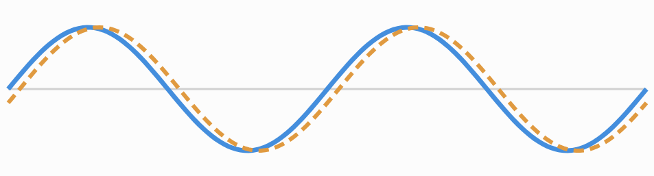
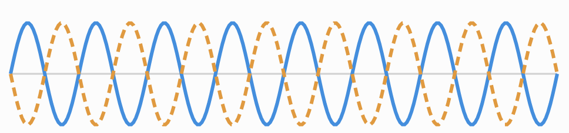

# 让 C++ 学会过滤声音（1）：从相位抵消到手搓 FIR 数字滤波器

在前面的文章中，我们让 C++ 从 PCM 样本写出 WAV 文件，又借助傅里叶级数和加法合成，把一个个正弦波组合成更复杂的音色。随后，我们又通过 ADSR 包络，让声音学会了出现、持续和消失。

但这时候的合成器仍然有一个问题：我们可以决定**生成哪些谐波**，也可以决定**音量怎样变化**，却还没有一个方便的办法，在声音生成之后继续塑造它的明暗、厚薄与质感。

在电子音乐制作中，只要稍微接触过合成器，大概就见过一个熟悉的旋钮：**Filter Cutoff**。拧低它，原本明亮的锯齿波会渐渐变暗；拧高它，高频又重新出现。

那么问题来了：计算机处理的明明是一串浮点采样值，它既看不到“明亮”，也摸不到“高频”，究竟是怎样把声音过滤掉的？

本章我们先不讨论复杂的模拟滤波器电路，也不急着推导 Z 变换。我们从一个容易观察的现象出发：**延迟一个声音，再与原声音叠加，会发生什么？**

## 一、从一个小实验开始：延迟和相位差

假设我们把一段信号复制两份，其中一份延迟一个采样点，再把二者以相同权重相加：
$$
y[n]=\frac{1}{2}x[n]+\frac{1}{2}x[n-1]
$$
它并不是简单地将振幅提高一倍。因为对于正弦波，延迟意味着相位改变。





我们可以注意到，当频率较低时，存在同等时间相位差的情况下，低频的信号抵消的程度要比高频要弱很多，如下为分析过程：

如果采样率为 (f_s)，一个采样点对应的时间间隔就是：
$$
\Delta t=\frac{1}{f_s}
$$
对于频率为 (f) 的正弦波，延迟这段时间产生的相位差为： 
$$
\Delta\phi=2\pi f\Delta t=\frac{2\pi f}{f_s}
$$
取
$$
f_s=44100\ \mathrm{Hz}
$$
延迟一个采样点约为 22.68 微秒。这个时间很短，但对不同频率的影响并不相同：100 Hz 的相位变化只有大约 0.82°；10 kHz 的相位变化达到约 81.63°；到了奈奎斯特频率 22.05 kHz，相邻采样点的相位差恰好是 180°。

而我们通过之前的学习，得知声音可以由多个不同的正弦波叠加而成，我们叠加存在同样时间差的低频和高频信号，对信号各个频段的响度衰减的影响有很大的区别。

这里要强调：**单纯延迟不会降低一个正弦波的振幅**。真正发生频率选择性衰减，是在延迟信号与原信号**加权相加**之后。低频的两个分量相位接近，能够较好地保留；较高频率的分量相位差更大，可能部分甚至完全抵消。

这就是理解 FIR 滤波器的第一个入口：不同延迟路径叠加后，会对不同频率产生不同影响。

不过，上面的两抽头滤波器只能让高频逐渐衰减，并不能在我们指定的某个频率上把高频全部一刀切掉。也正因为如此，我们才需要更多采样点和更精细的权重。

## 二、从两个采样点，推广到 FIR

继续把刚才的想法扩展一下。假如我们不仅使用当前样本与前一个样本，还使用更早的历史样本，并为每个样本赋予不同权重：
$$
y[n]=0.25x[n]+0.5x[n-1]+0.25x[n-2]
$$
这里的 ([0.25,0.5,0.25]) 就是一组 FIR 系数。这个例子是最简单的一类平滑滤波器，会对高频产生一定衰减。

如果需要使用 (M) 个系数，我们总不能无限地把公式展开，于是把它整理成：
$$
\boxed{y[n]=\sum_{k=0}^{M-1}h[k]x[n-k]}
$$
其中，x[n] 是输入采样，y[n]是输出采样，h[k]是系数，M 是抽头Taps数量。这个形式就是**离散卷积**在因果 FIR 滤波器中的计算方式。

本章不必把卷积当作一门新的高等数学课程。对目前的合成器而言，可以先记住一句话：**找到当前和过去的采样点，各自乘上系数，再把结果相加。**

FIR 是 *Finite Impulse Response*，即有限冲激响应。为什么系数又叫“冲激响应”？试着输入一段只有第一个采样为 1、后续全部为 0 的信号：
$$
x=[1,0,0,0,\dots]
$$
当系数为 ([0.25,0.5,0.25]) 时，输出恰好是：
$$
y=[0.25,0.5,0.25,0,\dots]
$$
也就是说，在零初始状态下，单位冲激输入能够直接“照出”这组滤波器系数。

## 三、第一版 C++：先在完整数组上做卷积

在此前的 WAV 章节，我们已经使用过 `std::vector<float>` 保存浮点 PCM 数据。现在继续沿用它，先实现一个离线函数：

```
inline std::vector<float> firFilter(
    const std::vector<float>& x,
    const std::vector<float>& c)
{
    if (c.empty())
        throw std::invalid_argument("Empty FIR coefficients");

    std::vector<float> y(x.size(), 0.0f);

    for (std::size_t i = 0; i < y.size(); ++i)
    {
        for (std::size_t j = 0;
             j < c.size() && j <= i; ++j)
        {
            y[i] += x[i - j] * c[j];
        }
    }

    return y;
}
```

注意最关键的一句：

```
y[i] += x[i - j] * c[j];
```

外层循环决定当前计算哪个输出采样点，内层循环负责依次取出过去的采样点，乘以相应系数并累加。`j <= i` 则避免在输入序列开头访问不存在的历史采样点，等价于假设输入开始之前全部为零。

这里的 `y` 与输入数组等长。如果希望得到有限信号与 FIR 系数的**完整线性卷积**，还需要保留末尾额外的 (M-1) 个输出采样；但在连续音频流的逐采样处理中，我们可以从这种等长输出形式开始。

一个小测试就可以验证公式：当 `x = {1, 0, 0, 0, 0}`、`c = {0.25f, 0.5f, 0.25f}` 时，输出的前五个值应为 `{0.25, 0.5, 0.25, 0, 0}`。

## 四、环形缓冲区

离线函数能读取整段输入数据，但合成器的 `Oscillator::process()` 往往每次只生成一个 Sample。滤波器如果也想每次处理一个 Sample，就必须**记住过去的输入**。

为此，我把 FIR 封装成了一个有状态的类：

```
#pragma once
#include <algorithm>
#include <cstddef>
#include <stdexcept>
#include <vector>

class FIRFilter
{
private:
    std::vector<float> coefficients_;
    std::vector<float> history_;
    std::size_t writeIndex_ = 0;

public:
    explicit FIRFilter(
        const std::vector<float>& coefficients)
        : coefficients_(coefficients),
          history_(coefficients.size(), 0.0f)
    {
        if (coefficients_.empty())
            throw std::invalid_argument("Empty FIR coefficients");
    }

    float process(float input)
    {
        history_[writeIndex_] = input;

        float output = 0.0f;
        std::size_t readIndex = writeIndex_;

        for (float coefficient : coefficients_)
        {
            output += coefficient * history_[readIndex];

            readIndex = (readIndex == 0)
                ? history_.size() - 1
                : readIndex - 1;
        }

        if (++writeIndex_ == history_.size())
            writeIndex_ = 0;

        return output;
    }

    void reset()
    {
        std::fill(history_.begin(), history_.end(), 0.0f);
        writeIndex_ = 0;
    }
};
```

这里最重要的不是 `class` 语法，而是 `history_` 和 `writeIndex_` 的配合。

例如，三个历史位置依次写入 `1、2、3`。当新输入 `4` 到达时，它会覆盖最旧的 `1`，内存里可能出现 `[4,2,3]`。但程序从最新写入的位置开始，**倒着读取并在末尾回绕**，得到的时间顺序仍然是 `4、3、2`。

这就是**环形缓冲区（Ring Buffer）**：不必为了加入一个新样本，就搬动整个历史数组。`process()` 内部也不需要每次分配新的 `vector`。

`reset()` 用来清空历史状态，适合在重新初始化滤波器或需要从零状态开始新测试时调用。但不要把它机械地放到每次 `Note Off` 上，否则可能截断滤波器尚未结束的响应。

## 五、怎么把 Cutoff 变成系数？

到这里，我们的 FIR 已经能运行了，但会遇到一个很现实的问题：

```
FIRFilter filter({0.25f, 0.5f, 0.25f});
```

真正的合成器应该允许我们说“我想要一个 2000 Hz 的低通滤波器”，而不是让用户手动猜几十个甚至上百个浮点系数。

因此，项目里又加入了 `FIRDesigner`：**滤波器设计器负责根据目标频率生成系数，**`**FIRFilter**` **只负责执行卷积。**

为什么系数能够决定频率？从直觉上讲，不同的加权延迟组合，会让正弦波在不同频率产生不同程度的相消或相长。换成数学语言，每组系数都对应一条**频率响应**曲线。

我们选用一个经典方案：**Windowed-Sinc（加窗 Sinc）低通 FIR**。

先写出理想低通对应的 Sinc 系数：
$$
h_d[m]=
\begin{cases}
2f_c/f_s,&m=0\
\dfrac{\sin(2\pi f_c m/f_s)}{\pi m},&m\ne0
\end{cases}
$$
其中 (m) 表示相对于系数中心的位置。理想 Sinc 向两边无限延伸，但计算机不可能储存无限个系数，所以我们只取奇数个 Taps，并乘上一个平滑两端的 **Hamming 窗**：
$$
w[n]=0.54-0.46\cos\left(\frac{2\pi n}{M-1}\right)
$$

$$
h[n]=h_d[n-(M-1)/2]\cdot w[n]
$$

最后，把所有系数除以它们的总和，使直流增益约为 1：
$$
h_{\mathrm{normalized}}[n]=\frac{h[n]}{\sum_k h[k]}
$$
C++ 中最关键的部分是：

```C++
const double frequency =
    static_cast<double>(cutoffHz) / sampleRate;

const std::size_t center = (taps - 1) / 2;

for (std::size_t i = 0; i < taps; ++i)
{
    const double offset =
        static_cast<double>(i)
        - static_cast<double>(center);

    const double sinc = (i == center)
        ? 2.0 * frequency
        : std::sin(2.0 * pi * frequency * offset)
            / (pi * offset);

    const double window =
        0.54 - 0.46 * std::cos(
            2.0 * pi * static_cast<double>(i)
            / static_cast<double>(taps - 1));

    kernel[i] = sinc * window;
    sum += kernel[i];
}
```

这段代码摘自我们已经完成的 `FIRDesigner::lowpass()`，为了突出计算逻辑，省略了参数校验和末尾归一化的实现。完整函数会检查采样率、Nyquist 范围和奇数 Taps，再返回 `std::vector<float>` 系数。

对于足够长、过渡带得到较好分辨的设计，传入的 `cutoffHz` 通常接近过渡带中间、约 −6 dB 的位置；但它**不是一个能够把高频完全切断的硬边界**，尤其当 Taps 很少时，更不能把它简单理解为精确的 −3 dB 或 −6 dB 截止点。

## 六、把两部分装进合成器

有了处理器和设计器，调用关系就清楚了：

```C++
const auto coefficients = FIRDesigner::lowpass(
    2000.0f, 44100.0f, 101);

FIRFilter filter(coefficients);
```

之后，在合成器中采用以下信号链：

```
Oscillator / AdditiveSynth
            ↓
         FIRFilter
            ↓
       ADSR / Velocity
            ↓
         PCM / WAV
```

逐采样处理可以概括成下面的伪代码（具体类名和接口以项目已有实现为准）：

```C++
float raw      = oscillator.process();
float filtered = filter.process(raw);
float gain     = envelope.process();
float output   = filtered * gain;
```

这里 `FIRDesigner` 应在**初始化或配置阶段**运行，而不是每次处理音频 Sample 时重新执行。它需要计算正弦、余弦并分配系数数组；真正每样本运行的应当是保存了历史状态的 `FIRFilter::process()`。

另一个值得注意的细节是**延迟**。对于当前使用的奇数抽头、对称系数线性相位 FIR，群延迟为：
$$
D=\frac{M-1}{2}\ \text{Samples}
$$
例如 101 Taps 对应 50 个采样点；在 44.1 kHz 下约为 1.13 ms。做原始音频与滤波音频的波形对照时，记得考虑这段延迟。对多个独立 Voice 或左右声道，也需要各自独立的滤波器历史状态。

## 七、三组 Cutoff 实验

既然已经把滤波器接进合成器，文章的最后就用同一个谐波丰富的锯齿波进行对照。可以在 44.1 kHz、101 Taps 的条件下，分别生成：

| 实验 | 设计截止频率 | 预期听感与频谱变化               |
| ---- | ------------ | -------------------------------- |
| A    | 不加滤波器   | 保留原始锯齿波的丰富谐波         |
| B    | 500 Hz       | 高频谐波被明显削弱，音色更暗     |
| C    | 2000 Hz      | 保留更多中低频谐波，声音相对明亮 |
| D    | 8000 Hz      | 保留更多高频，整体更接近原始波形 |

这里列出的是实验设计与理论预期。正式发布前，应该将真实 WAV、DAW 频谱截图以及 Cutoff 对应的响应曲线放在这里。听感比较时尽量保证输入相同、音量可比，并考虑 FIR 延迟。

顺便提醒一个常见误区：**在振荡器之后加入低通滤波器，不能自动修复振荡器生成阶段已经发生的混叠。** 前面加法合成里对奈奎斯特频率的限制仍然重要。

## 最后：声音第一次拥有了“明暗”

回头看本章，其实我们没有让 C++ 学会“识别高频”的能力，也没有在代码中一个频率一个频率地删除它们。

我们只做了三件事：把声音延迟、给不同延迟位置设置权重、把它们重新相加。而这些看似简单的时域操作，却能在频域中形成不同的衰减特性。

从一个两抽头的相位干涉实验，到离散卷积，再到环形缓冲区，最后让 `FIRDesigner` 把 Cutoff 转换为系数，我们的合成器终于能在波形生成以后继续塑造音色。

当然，这距离现代合成器的 Filter 还有一段路：为什么有的滤波器能够产生明显的 Resonance？为什么许多合成器偏爱 Biquad、SVF，甚至模拟梯形滤波器的反馈行为？

下一篇，就从另一个关键词出发：**反馈（Feedback）**。我们来看看 IIR 与 Biquad 如何以另一种方式改变声音。