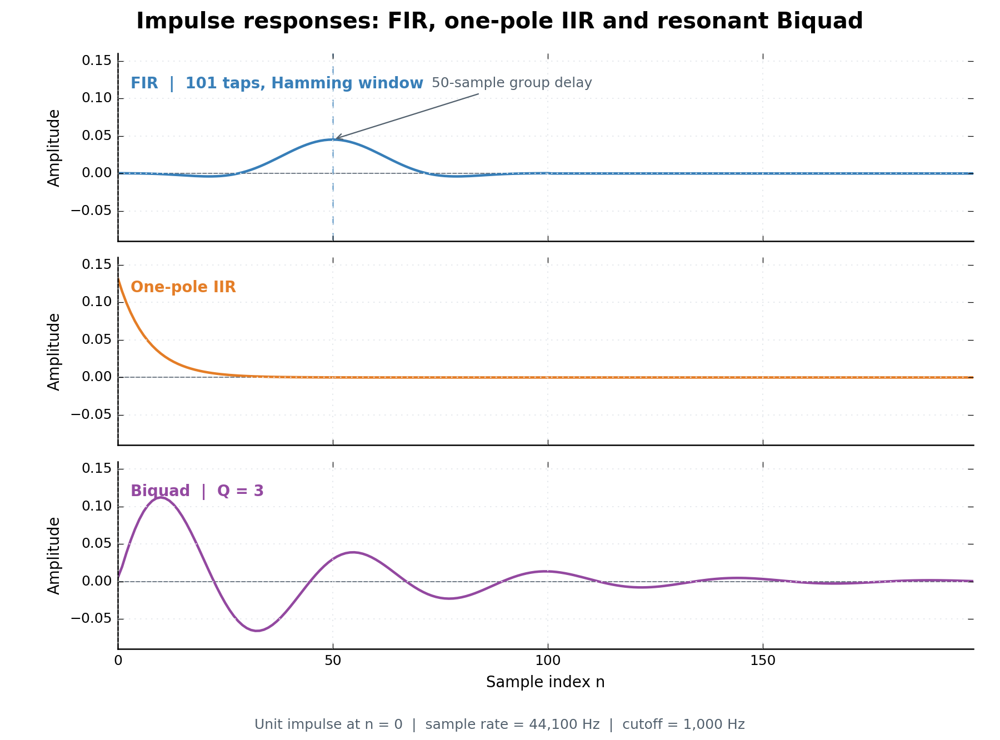
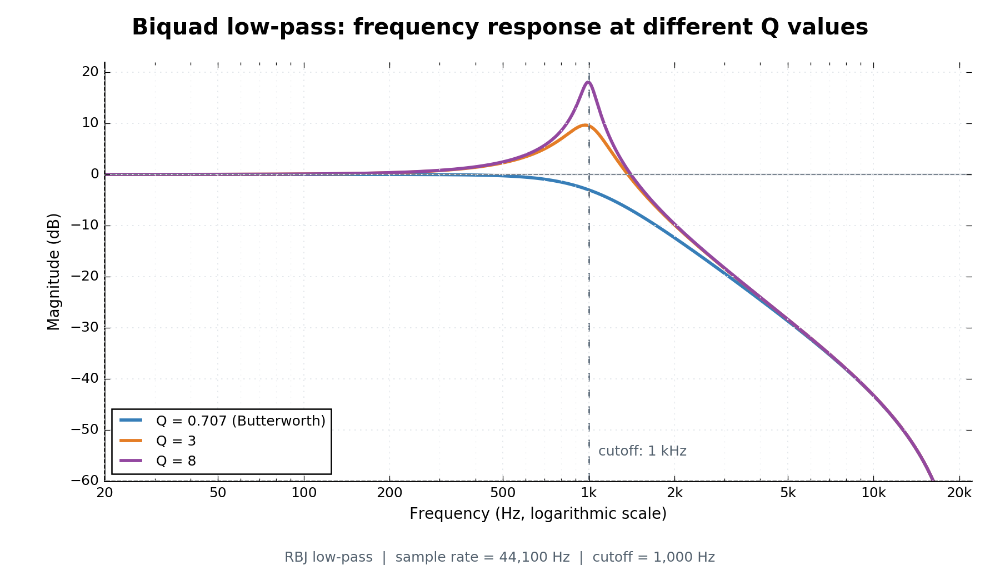

# 让 C++ 塑造音色：从 FIR 到 IIR 与 Biquad 共振滤波器

> 本篇承接上一节 FIR 滤波器教程，继续使用 C++ 实现一阶 IIR 低通与具有 Q 值控制的二阶 Biquad 低通滤波器。本文以当前项目的 `IIRDesigner`、`OnePoleFilter` 和 `BiquadFilter` 为基础。

在前面的课程中，我们已经实现了 FIR（Finite Impulse Response，有限冲激响应）滤波器，并初步了解了它如何通过卷积改变音频信号的频率成分。

FIR 有一个重要优势：**当系数满足特定对称条件时，可以实现严格的线性相位**。不过，如果希望在较窄的过渡频带内实现较强的频率衰减，FIR 往往需要更多系数；而 IIR（Infinite Impulse Response，无限冲激响应）通常可以用较低的阶数实现相近的幅频选择性。

对于电子音乐制作而言，滤波器不只是用于削弱高频，更是塑造音色的重要工具。经典的 TB-303 Acid Bass，便以具有鲜明共振特征的低通滤波器闻名。当然，TB-303 的特殊音色还涉及具体电路拓扑、非线性和包络调制，并非一个普通 Biquad 就能完整复现。

那么，**FIR 和 IIR 到底有什么不同？为什么加入反馈以后，我们就能进一步实现带共振的滤波器？**

本期我们先从一阶 IIR 的差分方程开始，随后将其扩展为二阶 Biquad，并在 C++ 中实现可控制 Cutoff 与 Q 值的共振低通。

## 一、从 FIR 到 IIR：改变的究竟是什么？

我们在上一节课中使用 FIR 对 PCM 样本执行加权求和。以一个简单的三抽头 FIR 为例：

$$
y[n]=b_0x[n]+b_1x[n-1]+b_2x[n-2]
$$

其中，x[n] 是当前输入，x[n-1] 和 x[n-2] 分别是此前的输入；b_0,b_1,b_2 则是滤波器系数。**输出只依赖当前与过去的输入，而不依赖过去的输出。**

IIR 则多出了另一条信息来源：**过去的输出**。这意味着滤波器会将先前计算的结果重新参与当前计算，形成反馈（Feedback）。

在继续介绍之前，我们先理解 IIR 名字中的“冲激响应”。

### 什么是冲激响应？

单位冲激是一个非常特殊的离散序列：

$$
\delta[n]=\begin{cases}1,&n=0\\0,&n\ne0\end{cases}
$$

将它送入一个初始状态为零的滤波器，观察后续的输出，便得到该滤波器的**冲激响应**。对于线性时不变（LTI）系统，冲激响应可以用来描述系统的行为。

FIR 的冲激响应在有限个采样点之后归零；典型的 IIR 则会持续衰减，理论上存在无限多个非零响应样本。这就是两者名称的来源。



*图 1：采样率 44,100 Hz、截止频率 1,000 Hz，输入为 n=0 时幅度为 1 的单位冲激。FIR 使用 101 个 Hamming 窗抽头；Biquad 的 Q=3。横轴为采样点，纵轴为未归一化的输出幅度；连线用于观察离散采样点的变化趋势。*

图中 FIR 的响应在 101 个抽头之后归零，对称中心位于第 50 个采样点，体现了该滤波器的 50 个采样点群延迟。一阶 IIR 的响应逐渐衰减；带共振的 Biquad 则呈现衰减振荡。图中仅显示前 200 个采样点，曲线接近零不意味着 IIR 的理论响应已结束。

这里的“无限”是数学意义上的，并不代表每个 IIR 都能永远发出可听见的声音。IIR 同样需要保证稳定性，否则反馈还可能造成输出发散。

## 二、最简单的 IIR：一阶低通滤波器

先来看一阶低通的差分方程：

$$
\boxed{y[n]=\alpha x[n]+(1-\alpha)y[n-1]}
$$

其中：

- x[n]：当前输入样本；
- y[n]：当前输出样本；
- y[n-1]：上一个输出样本；
- α：输入权重，1-\alpha 是反馈权重。

在 0<α<1的情况下，输出会在新输入和历史输出之间进行加权过渡。

假设 α=0.5，并且历史输出初始为零，那么：

$$
y[n]=0.5x[n]+0.5y[n-1]
$$

我们输入一个单位冲激：

```text
输入：1, 0, 0, 0, 0, ...
输出：0.5, 0.25, 0.125, 0.0625, 0.03125, ...
```

有意思的事情出现了：输入早已归零，但输出还在继续衰减。

原因是 y[n-1]被保留下来，继续参与下一次运算。与其说滤波器记住了所有历史样本，不如说它通过一个简短的**内部状态**浓缩了过去的影响。

如果你还记得之前 Oscillator 使用的相位累加器，就会发现两者在编程思想上很接近：振荡器通过保存 Phase 维持波形连续，IIR 则通过保存历史输出维持滤波过程连续。

## 三、用 C++ 实现 OnePoleFilter

在当前项目中，我将 IIR 的工作分成两部分：

- `IIRDesigner`：根据采样率与 Cutoff 计算系数；
- `OnePoleFilter`：利用系数与历史状态，逐样本执行滤波。

这种分工可以避免把滤波器的数学设计与实时信号处理混在一起。未来新增其他滤波器时，也更容易复用类似的接口。

### 3.1 保存系数与历史状态

一阶 IIR 核心需要三个变量：

```cpp
double alpha;               // 当前输入的权重
double feedback;            // 历史输出的反馈权重
double prevOutput = 0.0;    // 上一个输出样本
```

在当前实现中，`OnePoleFilter` 还会保存 `sampleRate` 和 `cutoffFrequency`，并在构造时通过 `IIRDesigner` 获取有效系数。

### 3.2 process()：每次处理一个 Sample

核心处理函数如下：

```cpp
double process(double input)
{
    prevOutput = alpha * input + feedback * prevOutput;
    return prevOutput;
}
```

这段代码对应的正是此前的差分方程：

$$
y[n]=\alpha x[n]+(1-\alpha)y[n-1]
$$

一次调用完成四件事：读取输入、读取历史输出、计算并保存新输出、返回新输出。

**注意顺序：新输出必须先写回 `prevOutput`，再返回。** 如果只计算局部变量 `output`，却始终返回旧的 `prevOutput`，就会得到错误结果；如果根本不更新历史状态，滤波器也无法形成预期的反馈。

在离线 WAV 处理时，我们还可以逐个遍历 Buffer，并反复调用同一个 `process()`。如果以后改成实时音频 Callback，同一个滤波器实例则应在相邻 Buffer 之间保留状态，而不能每处理一块就重新置零。

### 3.3 从 Cutoff 计算系数

音乐制作人熟悉的参数是 Cutoff Frequency（截止频率），而不是 \alpha。因此程序需要把以 Hz 表示的 Cutoff 转换为实际运算的系数。

一阶 IIR **并没有唯一的 Cutoff 到系数的换算公式**：不同的模拟原型与离散化方式会产生不同的数字滤波器。这里采用当前 `IIRDesigner::lowpassCoefficients()` 使用的设计：

$$
s=\sin\left(\frac{\pi f_c}{f_s}\right)
$$

$$
\boxed{\alpha=\frac{2s}{\sqrt{1+s^2}+s}}
$$

$$
feedback=1-\alpha
$$

其中，f_c 为截止频率，f_s 为采样率；要求 0<f_c<f_s/2。对于这种一阶数字低通设计，所指定的 Cutoff 对应约 -3\,\mathrm{dB} 的幅度响应点。

对应代码：

```cpp
constexpr double pi = 3.14159265358979323846;
const double sine = std::sin(pi * cutoffHz / sampleRate);
const double alpha = 2.0 * sine /
    (std::sqrt(1.0 + sine * sine) + sine);
const double feedback = 1.0 - alpha;
```

在当前实现中，`IIRDesigner` 负责校验采样率、Cutoff 和系数精度；`OnePoleFilter` 则通过 `setCutoffFrequency()` 或 `setSampleRate()` 更新参数。

这使得 DSP 计算与参数配置分离：**运行每个采样点时只做必要的乘加，不必重复调用三角函数。**

## 四、为什么一阶 IIR 还不够？

通过 OnePole，我们已经可以调整低通的 Cutoff，让锯齿波的高频谐波逐渐衰减。

但是，电子音乐里还有一种特别重要的效果：Resonance（共振）。

它并不是简单地提高整个信号的音量，而是让截止频率附近出现更突出的响应峰值。在 Acid、Techno 等音色中，共振会让滤波过程具有更鲜明的鸣叫感与运动感。

在常见的二阶低通系统中，Resonance 可以通过 Q（Quality Factor，品质因数）来控制。通常，Q 越高，截止频率附近的峰值越尖锐。

而我们此前采用的一阶单极点低通，频率响应基本是单调衰减的，无法以相同方式构造出这种可调谐的共振峰。

因此，我们需要一个具有更丰富极点结构的二阶滤波器：**Biquad**。

## 五、Biquad：从一阶走向二阶

Biquad 是非常常见的二阶数字滤波结构，通常可以表示为分子与分母最高为二次的传递函数：

$$
H(z)=\frac{b_0+b_1z^{-1}+b_2z^{-2}}{1+a_1z^{-1}+a_2z^{-2}}
$$

这里暂时不展开 Z 变换的完整推导。我们只需要知道，上式与下面的差分方程相对应：

$$
\boxed{y[n]=b_0x[n]+b_1x[n-1]+b_2x[n-2]-a_1y[n-1]-a_2y[n-2]}
$$

注意，这里假设分母首项系数已归一化为 1。为什么历史输出前面是减号？因为把分母对应的历史输出项移到等式右侧后，符号就变成了负号。

### 5.1 保存输入与输出的历史

相比一阶 IIR，Biquad 要保存两个过去的输入和两个过去的输出：

```cpp
double x1 = 0.0;  // x[n-1]
double x2 = 0.0;  // x[n-2]
double y1 = 0.0;  // y[n-1]
double y2 = 0.0;  // y[n-2]
```

此外，我使用 `BiquadCoefficients` 结构体保存系数：

```cpp
struct BiquadCoefficients
{
    double b0 = 1.0;
    double b1 = 0.0;
    double b2 = 0.0;
    double a1 = 0.0;
    double a2 = 0.0;
};
```

默认值表示直通状态：输入是多少，输出就是多少。真正应用滤波时，通过 `setCoefficients()` 设置设计器算出的系数。

### 5.2 根据差分方程实现 process()

核心运算几乎是对数学公式的逐项翻译：

```cpp
double output = coefficients.b0 * input
              + coefficients.b1 * x1
              + coefficients.b2 * x2
              - coefficients.a1 * y1
              - coefficients.a2 * y2;

x2 = x1;
x1 = input;

y2 = y1;
y1 = output;

return output;
```

这里**必须先算出当前输出，再更新历史状态**。否则就可能覆盖本次计算还需要使用的旧样本。

在当前项目中，这是一种直接 I 型（Direct Form I）的实现方式。`BiquadFilter` 同样提供 `reset()` 用于清空历史状态，并提供按 Buffer 处理的接口，在块与块之间延续状态。

## 六、用 Q 值控制 Biquad 的共振

Biquad 已经能够执行二阶差分方程，但滤波效果到底如何，还取决于五个系数怎样生成。

这里使用经典的 **RBJ Audio EQ Cookbook** 低通滤波器公式。

首先计算数字角频率：

$$
\omega_0=\frac{2\pi f_c}{f_s}
$$

以及：

$$
\alpha_{\mathrm{RBJ}}=\frac{\sin(\omega_0)}{2Q}
$$

这里使用 \alpha_{\mathrm{RBJ}} 以区别于前面一阶 IIR 的 \alpha。虽然两者都叫 Alpha，但含义完全不同。

对于二阶低通，未归一化的系数为：

$$
\begin{aligned}
b_0&=\frac{1-\cos(\omega_0)}{2}\\
b_1&=1-\cos(\omega_0)\\
b_2&=\frac{1-\cos(\omega_0)}{2}\\
a_0&=1+\alpha_{\mathrm{RBJ}}\\
a_1&=-2\cos(\omega_0)\\
a_2&=1-\alpha_{\mathrm{RBJ}}
\end{aligned}
$$

随后把 b_0,b_1,b_2,a_1,a_2 **统一除以 a_0**，得到前面差分方程所使用的归一化系数。注意，这里不是在同一组变量上进行数学恒等式，而是执行一次从原始系数到归一化系数的转换。

在 C++ 中，相关逻辑被封装为：

```cpp
const auto coefficients = IIRDesigner::BiquadLowpass(
    cutoffHz,
    sampleRate,
    resonanceQ
);

BiquadFilter filter;
filter.setCoefficients(coefficients);
```

例如，当 Q≈0.7071 时，这个二阶低通对应常见的 Butterworth 响应，其幅频响应在通带中最大平坦。随着 Q 提高，截止频率附近会出现越来越明显的峰值。



*图 2：采样率 44,100 Hz、截止频率 1,000 Hz，分别比较 Q=0.707、3 和 8；横轴为对数频率，纵轴为幅度增益（dB）。曲线由当前项目的 RBJ Biquad 系数计算得到。*

在标示的 1,000 Hz 处，三条曲线的增益分别约为 −3.01 dB、9.54 dB 和 18.06 dB。注意，Q 较高时增益峰值通常位于截止频率附近，而不一定恰好与截止频率重合。

但 Q 并不是百分比，也不等同于某台硬件合成器面板上的 Resonance 旋钮刻度。特别是当 Q 较高时，滤波器可能显著放大某一段频率，输出峰值甚至可能超出原始音频范围，实际使用时需要预留响度余量并监测削波。

## 七、FIR 与 IIR，到底谁更适合做合成器？

学到这里，我们已经有了三种不同的低通实现：先前的 FIR、本期的一阶 IIR，以及带有 Q 控制的二阶 Biquad。

它们的特点并不相同：

| 比较维度 | FIR                               | 一阶 IIR / Biquad IIR              |
| -------- | --------------------------------- | ---------------------------------- |
| 核心计算 | 当前与历史输入的加权和            | 当前及历史输入，并结合历史输出反馈 |
| 冲激响应 | 有限长度                          | 典型情况下理论上无限长             |
| 相位特性 | 特定对称系数可实现严格线性相位    | 通常为非线性相位                   |
| 稳定性   | 有限系数的 FIR 通常保证 BIBO 稳定 | 需要检查极点及数值稳定性           |
| 计算成本 | 取决于 Tap 数和实现方式           | 常能以较低阶数实现较强选择性       |
| 适用场景 | 线性相位处理、卷积等              | 实时音色塑形、参数均衡、共振滤波等 |

需要强调，**FIR 并不是天生都具有线性相位，IIR 也不一定在任何情况下都比 FIR 计算量小**。具体性能取决于阶数、目标频率响应、实现方法和运行环境。

对于本次合成器项目，一阶 IIR 很适合解释反馈和状态的概念；Biquad 则进一步提供 Cutoff 与 Q 两个直观的音色参数。

### 对照实验：同一段 Saw，经过不同滤波器

为了真正听出差异，我们可以让同一段锯齿波旋律进入不同的滤波链：

```text
                   原始 Sawtooth 音轨
                           │
             ┌─────────────┼──────────────┐
             │             │              │
            Dry           FIR            IIR
                           │              │
                     101-Tap LPF    ┌──────┴───────────┐
                                    │                  │
                                One-Pole           Biquad
                                                       │
                                             Q=0.707 / 3 / 8
```

建议试听与对比以下结果：

1. 原始 Dry 与 FIR 低通；
2. FIR 低通与一阶 IIR 低通；
3. 一阶 IIR 与 Q=0.707 的 Biquad；
4. 固定相同 Cutoff，比较 Q=0.707、3、8 的 Biquad。

**实验时务必从同一个 Dry Buffer 分别出发**，不要把 FIR 输出再送入 IIR，否则比较到的是串联滤波效果。此外，一阶、二阶与 101-Tap FIR 本就不是同样阶数的滤波器；即使 Cutoff 相同，频率响应也不会完全相同。若要比较输出波形，还应注意线性相位 FIR 的群延迟。

> **音频素材待补**：可在这里补充同一输入音符、不同滤波参数下生成的 WAV 试听链接，并注明输入音符和参数。

## 结尾：声音开始拥有自己的频谱形状

回顾整个系列，我们最早只是从 PCM 样本出发，让 C++ 输出第一段声音。随后通过傅里叶级数与振荡器组合波形，又通过 ADSR 让音符具有从开始到结束的生命周期。

而到了滤波器章节，我们开始更细致地塑造声音的频谱：不只是“让声音变大或变小”，而是决定**哪些频率被保留、哪些频率被衰减，以及截止频率附近是否产生共振**。

本期，我们从 FIR 的输入加权求和，走向 IIR 的递归反馈，再利用二阶 Biquad 引入 Q 值控制，让合成器第一次拥有了可调节的共振低通。

当然，我们目前主要研究的还是 **Low-Pass**。实际制作音乐时，高通、带通、陷波乃至更复杂的滤波器组合，同样十分重要。

**下一节，我们将继续使用 C++ 实现 High-Pass、Band-Pass 和 Notch，进一步拓展合成器的音色设计工具箱。**
