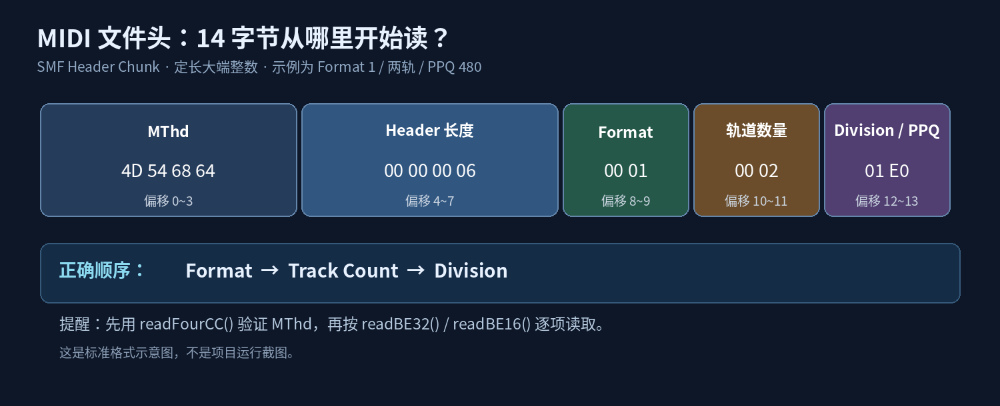
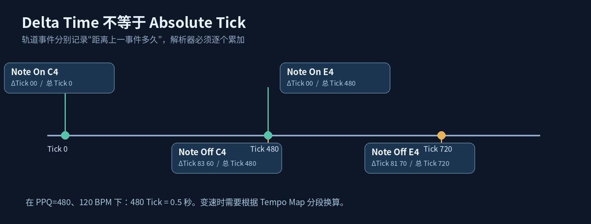
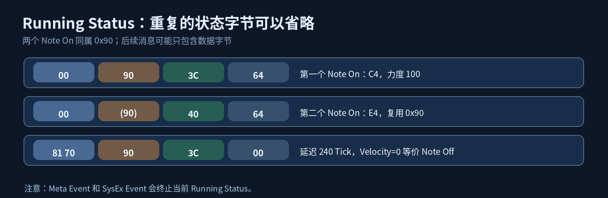
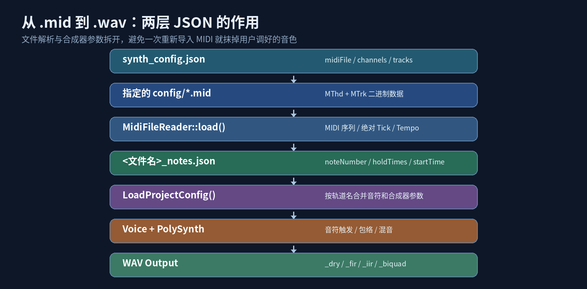

# 让 C++ 读懂乐谱：从手写 MIDI 文件解析器到可配置的软件合成器

此前我们用 `Oscillator` 产生波形、用 `Voice` 管理音符、用 `PolySynth` 混音，再将 Float PCM 写入 WAV 文件。但音符的编号、力度、开始时间和持续时长，还是直接放在 JSON 中。写一段三和弦当然方便，可要是来一段几十小节的旋律，难道还要自己逐个输入 `noteNumber` 和 `startTime` 吗？

这次我决定把 MIDI 文件接入 MiniAudioDSP。不是简单地调用第三方库得到一串音符，而是先把 `.mid` 当成二进制数据，**亲手解析格式，再转换成可以编辑和渲染的音符序列**。这个过程中，我也重新认识了一个概念：MIDI 文件并不是声音，而是一份有严格时间规则的演奏记录。



## 一、从 WAV 走向 MIDI：我们需要的是“演奏指令”

先回顾一下 WAV 和 MIDI 的区别。

WAV 中的 PCM 存储的是一个个采样值。比如 44.1 kHz 采样率意味着每秒需要生成 44100 个采样帧。播放器按照采样率读取这些数值，就能够还原声音。

MIDI 则不同。它记录的是类似“第几个时刻，哪个通道按下了哪个音符，力度是多少；过了一段时间，再松开这个音符”的事件。

也就是说，MIDI 文件不负责决定 C4 究竟是钢琴、锯齿波还是方波。**音色由合成器决定，MIDI 负责告诉合成器演奏什么、何时演奏。**

这次我们要建立的流程是：

```text
Standard MIDI File (.mid)
        ↓ 解析二进制结构
MidiSequence（音符事件、时间信息）
        ↓ 配对 Note On / Note Off，并换算时间
<文件名>_notes.json
        ↓ 与音色设置合并
Voice / PolySynth
        ↓ 合成 Float PCM
WAV Output
```

这里把 MIDI 解析、配置与音频渲染分开，也是本次开发最重要的架构选择。

## 二、MIDI 文件不是一串三字节消息

Standard MIDI File（简称 SMF）由一个 `MThd` 文件头，以及后续的一个或多个 `MTrk` 轨道块组成。

```text
MThd
├── Header Length           4 bytes
├── Format                  2 bytes
├── Track Count             2 bytes
└── Division                2 bytes

MTrk
├── Track Length            4 bytes
└── Event Stream
    ├── Delta Time + Event
    ├── Delta Time + Event
    └── ... + End of Track
```

文件头固定以四个 ASCII 字符 `MThd` 开始。随后是 Header 数据长度，标准长度通常为 6。三个两字节字段的**正确顺序**是：`Format`、`Track Count`、`Division`。

以图中的示例为例：

| 偏移 | 十六进制字节 | 含义 |
|---|---|---|
| 0～3 | `4D 54 68 64` | `MThd` |
| 4～7 | `00 00 00 06` | Header 长度为 6 |
| 8～9 | `00 01` | Format 1 |
| 10～11 | `00 02` | 2 条 Track |
| 12～13 | `01 E0` | 每个四分音符 480 Tick |

其中，Format 0 把事件放在一个轨道块中；Format 1 允许多个轨道共享时间轴。当前 `MidiFileReader` 对应的目标范围是 Format 0 和 1，不支持 Format 2，也不支持 `Division` 的 SMPTE 时间格式。

### 从小端 WAV 到大端 MIDI

此前我们写 WAV 时，曾经遇到 Little-Endian（小端序）。比如 `0x12345678` 在小端格式中按 `78 56 34 12` 存储。

MIDI 的这些定长多字节整数使用 Big-Endian（大端序），即高有效字节在前。例如：

```text
01 E0  →  0x01E0  →  480
```

所以这次不能直接复用原来的 `WriteU16LE()`。我们需要的是专门读取大端序整数的函数，例如 `readBE16()` 和 `readBE32()`。

## 三、`ByteSpan` 与 `ByteCursor`：让解析器只读自己该读的字节

一开始，解析 MIDI 看起来无非是 `std::ifstream` 读文件，按偏移提取若干字节。但这有个隐藏问题：如果某个事件宣称自己的数据长度是 100 字节，实际上轨道只剩下 3 字节，该怎么办？

如果不在边界处检查，解析器可能越过当前 Track，甚至访问越界数据。

因此本次实现把底层读取拆成两个小类。

**`ByteSpan`** 表示一段字节区间，内部保存指针和长度；**`ByteCursor`** 在这个区间上前进，负责检查剩余可读字节。

在 `ByteCursor` 中，核心不是某个复杂的解析算法，而是 `take()`：

```cpp
ByteSpan take(std::size_t count)
{
    if (count > remaining())
        throw std::runtime_error(
            "Truncated MIDI file or event exceeds chunk boundary");

    auto result = bytes_.subspan(position_, count);
    position_ += count;
    return result;
}
```

这里是对实际代码的精简展示。原实现还会在异常信息中报告偏移、请求长度和剩余长度。

`readU8()` 只读取一个字节；`readBE16()`、`readBE32()` 依次读取多个字节，并使用移位运算还原数值。例如：

```cpp
std::uint16_t readBE16()
{
    const auto a = readU8();
    const auto b = readU8();
    return static_cast<std::uint16_t>(
        (static_cast<std::uint16_t>(a) << 8) | b);
}
```

`readFourCC()` 则用来读取 `MThd` 和 `MTrk` 这样的四字符标识。

更重要的是，解析 `MTrk` 时，我们会先读取它声明的 `Track Length`，然后用 `file.take(trackLength)` 创建**仅覆盖当前轨道数据的读取区间**，再交给 `parseTrack()`。

于是，即使轨道内部数据有误，也不能通过这个 `ByteCursor` 继续吞掉后续轨道的字节。异常不再只是最后一次性的“读取失败”，而是在问题发生的位置尽早暴露。

### MIDI 特有的 VLQ

还有一件事和 WAV 不同：MIDI 的 Delta Time 使用 Variable Length Quantity（VLQ，可变长度整数）。SMF 中这里采用 1～4 字节编码，每个字节最低 7 位存储数值，最高位表示后面是否还有字节。

例如 `83 60`：

```text
83 = 1000 0011  → 数据部分 0000011，后面还有
60 = 0110 0000  → 数据部分 1100000，最后一个字节

(3 × 128) + 96 = 480 Tick
```

对应的解析函数非常紧凑：

```cpp
std::uint32_t readVLQ()
{
    std::uint32_t result = 0;
    for (int i = 0; i < 4; ++i) {
        const auto byte = readU8();
        result = (result << 7) | (byte & 0x7FU);
        if ((byte & 0x80U) == 0)
            return result;
    }
    throw std::runtime_error("Invalid MIDI VLQ: exceeds 4 bytes");
}
```

这段代码同时给 VLQ 设置了长度上限。出现第五个连续字节、文件意外结束等情况时，解析器明确抛出异常，而不是继续使用不可信的数据。

## 四、`parseTrack()`：最难的不是 Note On，而是时间

轨道事件通常按这样的结构排列：

```text
Delta Time → Event
Delta Time → Event
Delta Time → Event
...
```

注意，**Delta Time 不是从歌曲开头计算的时间，而是相对于同一轨道上一个事件的时间差**。



所以 `parseTrack()` 不能每次只记录当前 `delta`，而必须累加到绝对 Tick：

\[
t_{\mathrm{absolute},n}=\sum_{k=0}^{n}\Delta t_k
\]

实际代码中的关键步骤如下：

```cpp
std::uint64_t tick = 0;

while (!data.empty()) {
    const auto delta = data.readVLQ();
    if (tick > std::numeric_limits<std::uint64_t>::max() - delta)
        throw std::runtime_error("Tick value overflow");
    tick += delta;

    // 再根据事件开头的字节决定如何解析
}
```

比如第一个 Note On 在 Tick 0，第二个事件相隔 480 Tick，那么第二个事件的绝对位置就是 480。之后如果 Delta Time 为 0，第三个事件也发生在 Tick 480。

这看起来只是加法，但如果忘记执行 `tick += delta`，后面所有音符的时间都可能被解释错。开发过程中确实遇到过这个问题，因此现在还特别检查 Tick 累加是否溢出。

## 五、Channel Event 与 Running Status：文件会“省略重复说明”

在 MIDI Channel Message 中，状态字节告诉我们事件类型与通道。例如：

```text
90 3C 64
│  │  └── Velocity = 100
│  └───── Note Number = 60（常见音名记法为 C4）
└──────── Note On，通道索引 0
```

状态字节的高四位表示事件类型，低四位表示通道（0～15）。

`0x90` 是 Note On；`0x80` 是 Note Off。还有 Control Change、Pitch Bend、Program Change、Aftertouch 等通道消息。当前解析器能识别并保存这些事件类型，但**本次离线音符渲染主要消费 Note On / Note Off，并没有实现完整控制器自动化或音色切换**。

### Velocity 为零的 Note On

MIDI 允许用 Velocity 为 0 的 Note On 来表达 Note Off。因此：

```text
90 3C 00
```

应按 Note Off 处理，而不是把它当作一个力度为零、仍需保持按键状态的新音符。

这里也曾出现过一个小 Bug：使用了错误的数据字节判断 Velocity。修复后的思路是明确区分 `data1`（音符号）与 `data2`（力度），再让 `decodeType()` 判断事件类型。

### Running Status

为了缩小文件体积，连续使用同一个状态字节时，后面的事件可以省略这个状态字节，这叫 Running Status。



例如：

```text
00 90 3C 64   // Note On：60、力度 100
00    40 64   // 继续使用 0x90：64、力度 100
```

如果解析器每次都假设第一个字节必然是新的状态码，第二条消息就会读错。

当前 `parseTrack()` 用 `runningStatus` 保存上一次可复用的通道状态。当事件开头的最高位为 0 时，沿用之前的状态；但如果没有合法的历史状态，必须报错。

另外还要记得，**Program Change（`0xC0`）与 Channel Aftertouch（`0xD0`）只有一个数据字节**。如果无论什么消息都读两个数据字节，整个文件的解析位置会从此错开。

最后，解析器还会检查 Channel Status 必须位于 `0x80`～`0xEF`，并使用 `readDataByte()` 拒绝不合法的高位数据字节。

## 六、Meta Event：不是每个 `0xFF` 都代表轨道结束

如果说 Running Status 是压缩消息，Meta Event 则更像是附带在演奏事件中的说明信息。

它的格式通常为：

```text
FF <Meta Type> <VLQ Length> <Payload>
```

其中最重要的是两个事件。

**`0x51`：Set Tempo**，规定每个四分音符对应多少微秒，长度必须为 3 字节。例如 `07 A1 20` 表示 500000 微秒/四分音符，也就是 120 BPM。

**`0x2F`：End of Track**，表示本轨道结束，标准载荷长度为 0。

开发中曾经犯过一个错误：把所有 Meta Event 都当成 Track 的结束标记。这样的处理会让程序遇到 Tempo、拍号或者文本信息时提前停止读取，导致后面的音符凭空消失。

现在的处理逻辑是：先读取 Meta 类型和长度，按长度取出 Payload；只有类型为 `0x2F` 才结束 Track。遇到 `0x51` 则只将 Tempo 信息记录到 `sequence.tempos`，不会把它再重复写进列表。

`parseTrack()` 在遇到 `End of Track` 时检查长度和剩余字节；如果轨道已经读完却仍未遇到这个事件，则抛出：

```text
MIDI track is missing End of Track meta event
```

其他未知 Meta Event 并不意味着整个文件无效。只要它携带的长度合法，就可以跳过 Payload，继续解析后面的事件。

此外，`0xF0` 与 `0xF7` 表示的 SysEx 相关事件，目前按声明的长度跳过，并清空 Running Status。Meta Event 也会清空 Running Status。这些规则看似零散，却是让解析器面对真实 MIDI 文件时不至于错位的关键。

## 七、`load()` 与 `parse()`：文件 I/O 和字节协议分工

在工程设计上，我没有让一个函数同时负责打开文件、解析 Header、遍历所有轨道，再把结果直接交给合成器。

当前 `MidiFileReader` 对外提供两个入口：

```cpp
static MidiSequence load(const std::filesystem::path& filename);
static MidiSequence parse(std::istream& input);
```

`load()` 负责用二进制模式打开路径，将文件读入字节缓冲区；`parse(std::istream&)` 则可以接受内存流，便于构造测试样本。两者最终共用相同的底层字节解析逻辑。

例如，在测试中可以通过 `std::istringstream` 构造最小的二进制 MIDI，而不需要每次真的建立文件；同时，还要单独测试 `load()` 能否正确处理磁盘中的临时 MIDI 文件。

这样设计的好处不在于代码行数变少，而是**测试“文件能否读取”与“字节能否正确解释”时，不必把两件事绑死在一起。**

## 八、从 Tick 到秒：MIDI 的音乐时间怎样落到音频时间轴？

解析结束后，`MidiSequence` 已经保存了每条轨道上的绝对 Tick 和 Tempo 变化。但 `Voice` 的 `startTime` 和 `holdTime` 使用的是秒，二者仍需转换。

如果一首曲子的速度始终为 120 BPM，并且 PPQ=480，那么一个四分音符需要：

\[
T_{\mathrm{quarter}}=\frac{60}{120}=0.5\,\mathrm{s}
\]

因此：

\[
T_{\mathrm{tick}}=\frac{0.5}{480}\,\mathrm{s}
\]

例如 Tick 720 对应 0.75 秒。

但 MIDI 允许中途改变速度，因此不能从头到尾使用一个固定的 BPM。当前 `midi_json_writer.cpp` 中的 `TickToSeconds()` 会先按 Tick 排序 Tempo 事件，从缺省的每四分音符 500000 微秒开始，依次累加每一段的实际时间：

\[
\Delta T=\frac{\Delta\mathrm{Tick}\times\mu}{\mathrm{PPQ}\times10^6}
\]

其中 \(\mu\) 是该段时间使用的微秒/四分音符。

```cpp
seconds += static_cast<double>(tempo.tick - currentTick)
           * microsecondsPerQuarter
           / (static_cast<double>(ticksPerQuarter) * 1000000.0);
```

到下一个 Tempo Event 时更新 \(\mu\)，继续往后累计。这就实现了按分段速度换算 Tick 到秒，而不是把整首曲子硬套到同一个 BPM 上。

当前代码保留的是转换音符时所需的时间数据，并没有实现实时播放指针、节拍同步 LFO 或完整 Transport 控制系统。

## 九、从 MIDI 事件到可以编辑的音符 JSON

有了秒数之后，我们还需要做一件事：**把一次 Note On 和对应的 Note Off 配成一个完整的音符。**

因为我们的合成器目前需要的是：

```text
Note Number
Velocity
Start Time
Hold Time
```

而 MIDI 文件里往往只有“按下”和“松开”两个分开的事件。

在 `MakeNotesJson()` 中，我使用一个以 `(channel, note number)` 为 Key 的容器，分别保存尚未结束的音符。这样至少能够区分不同通道、不同音高的重叠音符，同音高重复触发时则按当前容器中的先入顺序配对。

遇到 Note On，就记录 Tick 和力度；遇到匹配的 Note Off，就将开始、结束 Tick 分别转换为秒，计算音符持续时长：

\[
\mathrm{holdTime}=\max(0,T_{\mathrm{off}}-T_{\mathrm{on}})
\]

MIDI Velocity 范围为 0～127，转入当前合成器的归一化力度时使用：

\[
v=\frac{\mathrm{Velocity}}{127}
\]

例如力度 100 大约变成 0.7874。

最终得到四个等长数组：

```json
{
  "noteNumber": [60, 64],
  "noteVelocity": [0.7874, 0.7874],
  "holdTimes": [0.5, 0.25],
  "startTime": [0.0, 0.5]
}
```

**以上数字只是说明字段关系的示例，不是从某个实际 MIDI 文件截取的测试结果。**

对于只有 Tempo、没有音符的 Track，`WriteMidiNotesJson()` 会跳过，不在最终音符 JSON 中创建空音轨。对于出现 Note On 却直到轨道结尾都没有 Note Off 的音符，当前实现将它延续至该 Track 的 `endTick`，避免静默丢失。

这里也有一个明确的版本边界：尽管配对时按通道区分，最终写入 JSON 的四个数组**没有保留 MIDI 通道字段**。因此当前结果主要用于“读取音符时间并以指定音色渲染”，不能直接等同于无损保留全部 MIDI 演奏信息。

## 十、两份 JSON：音符可以换，音色不用重调

接下来就是这次改动中我很喜欢的一部分：配置设计。

如果把 MIDI 解析结果和合成器所有参数都写进同一份 JSON，下一次重新导入 MIDI 时，很容易覆盖用户已经调好的音色。

所以现在分成两份文件：

`config/synth_config.json`：保存要使用的 MIDI 文件名、WAV 输出声道数，以及每条音轨的振荡器、ADSR 和滤波器参数。

`config/<midi 文件名>_notes.json`：保存 MIDI 产生的音符序列，包括 `noteNumber`、`noteVelocity`、`holdTimes`、`startTime`。

一个简化的合成器配置如下：

```json
{
  "midiFile": "demo.mid",
  "channels": 2,
  "tracks": {
    "midi_track_0": {
      "wavetable": "sawtooth",
      "curveType": "linear",
      "ADSR_config": [0.01, 0.2, 0.4, 0.5],
      "cutoff": 1200.0,
      "resonance": 0.8,
      "type": "lowpass",
      "voiceFilter": {
        "enabled": false,
        "amount": 2.0,
        "curveType": "linear",
        "ADSR_config": [0.05, 0.3, 0.3, 1.5]
      }
    }
  }
}
```

`channels` 指的是 WAV 输出声道数，**不是 MIDI 的 Channel 编号**。当前 WAV 写入逻辑将相同的单声道采样复制到各输出声道，并非已经实现了空间声像或独立多声道声部。



程序首先读取 `synth_config.json` 的 `midiFile` 字段。为什么不扫描目录，自动找一个 `.mid`？因为目录里如果有三四份 MIDI，程序凭什么知道我们想渲染哪一份？

当前实现要求 `midiFile` 是 `config` 目录中的一个 `.mid` 或 `.midi` 文件名，并拒绝带父目录的路径。这能阻止普通的 `../` 路径跳转；但它并不是一套完整的文件系统沙箱策略，不能因此声称对所有符号链接情形都有防护。

当对应的 `_notes.json` 不存在时，程序调用 `MidiFileReader::load()` 并生成音符文件；如果文件已经存在，则直接复用，保留手动修改的音符数据。

在渲染前，`LoadProjectConfig()` 按 `midi_track_0` 这样的轨道名查找两份 JSON，把音符数组合并到音色配置的 `note` 字段，再由 `ParseTrack()` 转换为 `TrackConfig`。

这里也意味着一个实际约束：**重新编辑原始 MIDI 文件，并不会自动让现有 `_notes.json` 跟着更新。** 想重新导入时，需要明确处理旧缓存，而不能误以为程序自动跟踪了原始文件变动。

同时，当前启动顺序要求 `synth_config.json` 先存在并包含合法的 `midiFile`。虽然源码提供 `WriteDefaultSynthConfigJson()`，但不能据此描述成“首次运行无需任何配置就会自动创建完整工程”。

## 十一、MIDI 驱动的 Voice 渲染：完成到哪一步了？

合并配置以后，现有的 `RenderTrack()` 不需要关心 MIDI 文件怎样编码，它拿到的已经是 `TrackConfig` 中的音符列表。

随后项目采用既有的**每个音符预先对应一个 `Voice`** 的离线合成方法，调用 `PolySynth::generate()`，根据 `startTime` 和 `holdTime` 在相应的采样帧触发 `noteOn()` / `noteOff()`。

例如：

```cpp
auto buffer = synth.generate(
    noteNums,
    velocities,
    holdTimes,
    startTimes);
```

这一步让 MIDI 文件中的演奏时间真正进入声音生成过程。

目前渲染结果保留 `dry`、`fir`、`iir`、`biquad` 四种 Buffer，分别导出相应 WAV。`Biquad` 的类型通过配置的 `type` 选择。

需要特别说明：项目源码中虽然已经有独立的 `voice_manager` 类型，带有 `noteOn()`、`noteOff()`、`process()`，但本次主渲染流程仍是 `RenderTrack()` 和 `PolySynth::generate()` 的离线方案。不能把两者混为一谈，更不能声称已经完成实时 MIDI 事件流、设备输入或动态复音分配引擎。

## 十二、开发过程中踩过的坑，比“能播放”更值得记录

这次开发留下的几个错误，刚好对应 MIDI 格式中最容易弄错的边界。

| 遇到的问题 | 为什么会出错 | 对应修复或防护 |
|---|---|---|
| Header 字段顺序混淆 | Track Count 与 Division 都是 2 字节 | 按 `Format → Track Count → Division` 读取； |
| 忘记累加 Delta Time | 把事件间隔当成绝对时间 | 每次解析后执行 `tick += delta`，并检查溢出 |
| 遇到所有 Meta Event 就结束 | 误将 `0xFF` 视为结束标记 | 仅 `0x2F` 结束 Track；`0x51` 单独记录 Tempo |
| 判断零力度时读错字段 | 将音符号当作 Velocity | 使用 `data2` 判断 Note On 是否等价 Note Off |
| Tempo 重复记录 | 在多个解析分支写入同一事件 | 集中在 `0x51` 分支只记录一次 |
| Running Status 错位 | 把普通数据字节当成状态字节 | 缓存合法通道状态，Meta / SysEx 时清零 |
| 忽略一字节消息 | `0xC0`、`0xD0` 与普通 Note 消息长度不同 | 按消息类型决定读取 1 或 2 个数据字节 |
| 忽略 Track 结束校验 | 截断文件可能被误认为正常结束 | 必须检查 `0x2F`，并验证其长度和剩余数据 |
| 跨 Track 读取 | 不信任但又没限制 Chunk Length | 使用有界 `ByteCursor` 和 `take()` |

这些问题的共同点是：它们不一定立刻让程序崩溃。有时更糟糕，程序会返回一串“看起来合理”的音符，却已经把开始时间、音高或事件边界读错了。

所以，**二进制解析的正确性不能只靠运行一次不报错来判断。**

## 十三、测试：不能只检查程序有没有崩溃

根据本次开发记录，已有 `midi_file_reader_test` 用例覆盖 Header、Track、Tempo 数量、Tick 累加、Note On / Note Off、零力度 Note On、临时 MIDI 文件读取、JSON 音符序列生成，以及缺少 End of Track 时是否抛出异常。

构建与测试流程采用 CMake/Ninja 与 CTest。这里需要区分两种证据：这份随文提供的 `src.zip` 能检查解析与渲染源码，但没有附带 CMake 配置、测试源码与完整运行日志，因此本文**不声称重新执行了完整构建、CTest 或主观听感验证**。

如果设计测试数据，我建议至少分别断言下面这些结果，而不是只看解析函数能否返回：

1. 读入一个 Format 0 的最小文件，`format`、Track 数量和 PPQ 应与 Header 字节相符。
2. 使用 `83 60` 作为 Delta Time，第二个事件必须位于绝对 Tick 480。
3. `90 3C 00` 必须被识别为 Note Off。
4. 同一 Track 中出现 Tempo、其他 Meta Event 后，解析必须继续直至 `FF 2F 00`。
5. 文件被截断、VLQ 超过四字节或缺少 End of Track 时，必须抛出明确异常。
6. 把最小 MIDI 写入临时文件后，通过 `load()` 验证实际文件路径读取。
7. 将事件转换为 `_notes.json` 后，验证音符数量、起止秒数和归一化力度。

只有同时验证“正确输入得到正确结果”和“错误输入被明确拒绝”，解析器才算真正开始可靠。

## 十四、滤波器与 Filter ADSR：已有能力，但不是本章主角

把 MIDI 导入跑通之后，项目原有的 DSP 模块仍然能够继续使用。

目前的声音处理链已有 FIR、一阶 IIR 与 Biquad。Biquad 支持低通（Low-Pass）、高通（High-Pass）、带通（Band-Pass）和陷波（Notch）。在 Voice 内，独立的 Filter ADSR 还能通过八度数量调整截止频率：

\[
f_c[n]=\operatorname{clamp}\left(f_{\mathrm{base}}\cdot2^{A E[n]},\ f_{\min},\ f_{\max}\right)
\]

其中 \(A\) 为八度调制深度、\(E[n]\) 为当前包络值。

需要提醒的是：固定系数的 Biquad 可以作为 LTI 系统分析，但当 ADSR 持续改变系数时，整个滤波过程已经是时变系统，不能再用一组固定的 \(H(z)\) 完整描述。

同时，当前滤波系数仍会在音频处理过程中更新。这是实验项目已经实现的功能，不意味着完成了复杂复音场景下的实时性能优化。Filter ADSR、LFO 与未来的音乐时间系统，都适合放在后续章节详细讨论。

## 结语：从会发声，到能读懂演奏

这次写 MIDI 解析器，我最大的收获并不是终于能把 `.mid` 读进内存，而是学会了如何把一个外部二进制协议变成可测试、可编辑、可复用的内部数据结构。

`ByteCursor` 负责字节边界，`parseTrack()` 负责事件状态机，`TickToSeconds()` 负责音乐时间与秒数的换算，`WriteMidiNotesJson()` 负责把事件变成音符序列，而 `LoadProjectConfig()` 则把演奏信息和音色参数重新拼合起来。

最后，`Voice` 与 `PolySynth` 并不需要认识 `MThd`、`MTrk` 或 VLQ。它们只需要回答一个朴素的问题：**现在应该让哪个音符发声？**

从手写 WAV 的那一刻起，C++ 学会了把数字写成声音；而到了这一章，它开始能够读懂别的音乐软件留下的演奏记录了。

### 读者可以继续实践

- 用纸笔手算一组 VLQ，例如 `83 60`，再与 `readVLQ()` 的结果对照。
- 自行构造一个含两个 Note On、两个 Note Off、一个 Tempo 的最小 MIDI，通过 `parse(std::istream&)` 检查绝对 Tick。
- 试着移除 `End of Track`，确认 `parseTrack()` 会拒绝这个不完整文件。
- 修改 `synth_config.json` 的 `wavetable`、`ADSR_config` 与 `type`，观察同一份 `_notes.json` 如何驱动不同的合成参数。
- 比较 `PPQ=480`、120 BPM 下 Tick 480 的秒数，并思考出现 Tempo Change 时为什么必须分段计算。

---

### 格式资料与配图说明

本文的四张技术图（Header 布局、事件时间轴、Running Status、配置渲染流程）均为根据 MIDI 规范和当前项目结构重新绘制的原创示意图，不是软件运行界面的截图。图片可作为本文章节配图使用。

供进一步阅读的资料：

- [MIDI Association：Standard MIDI Files](https://midi.org/standard-midi-files)
- [Standard MIDI File 结构与事件格式说明](https://midi.community/docs/smf/)
- [Standard MIDI File 规范文本，含 Running Status 与 Meta Event](https://midimusic.github.io/tech/midispec.html)
- [MathWorks：MIDI 文件消息结构示例](https://fr.mathworks.com/help/audio/ug/convert-midi-files-into-midi-messages.html)（外部视觉参考，未直接转载其图片）

**源码核对口径：** 技术接口与渲染架构以本次上传的 `src.zip` 为基础；Header 顺序修复以开发者本轮补充说明为准。`src.zip` 未包含测试源码、CTest 执行日志或修复后的重新打包版本，因此不要将文内有关测试覆盖的开发记录理解为本文作者已重新验证最新本地版本。
